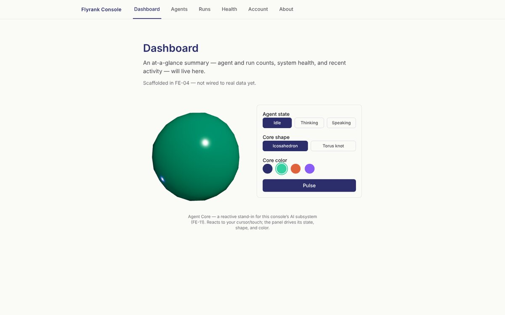
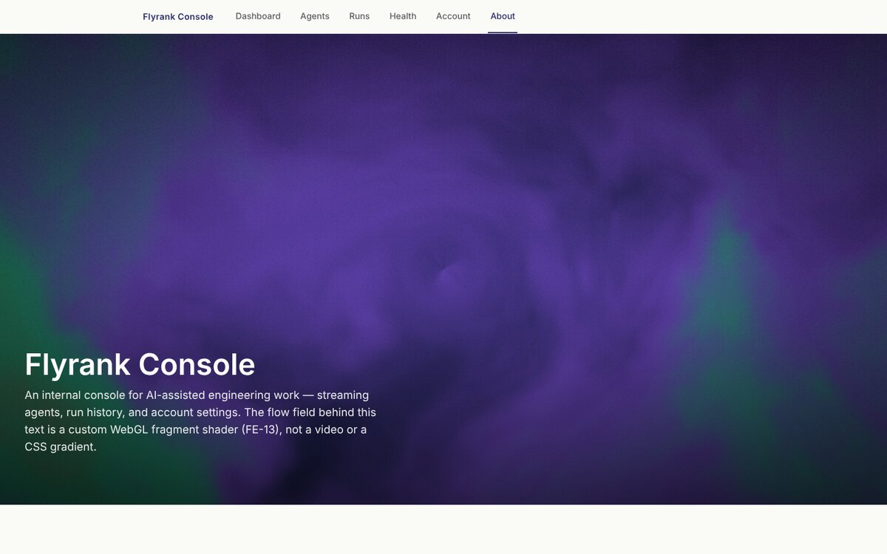
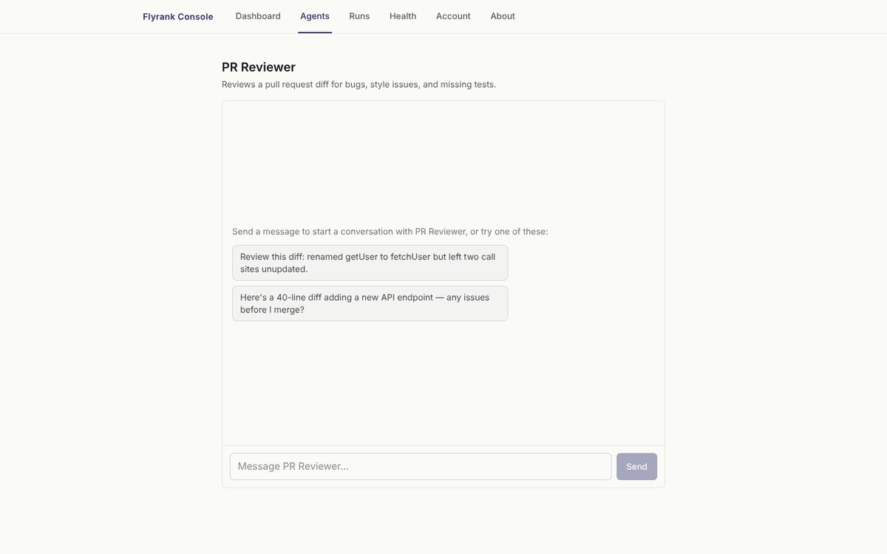
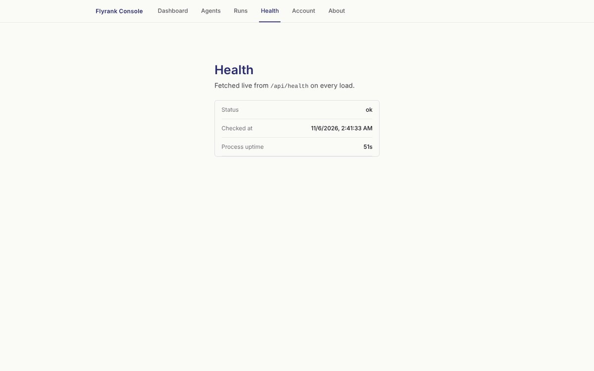

# Flyrank Console

An internal console for AI-assisted engineering work — streaming chat with a set of
purpose-built agents, a reactive 3D dashboard hero, a custom WebGL shader hero, and the
account/health scaffolding around them. Built across 14 assignments in FlyRank's "Frontend
Development with AI" internship track, with [Claude Code](https://code.claude.com/) doing most
of the implementation under direction and review at every step — see
["How AI tools built this"](#how-ai-tools-built-this) below for specifics, not a marketing line.

**Live:** [flyrank-ai-frontend.vercel.app](https://flyrank-ai-frontend.vercel.app)

## Screenshots

| Dashboard — Agent Core (FE-11) | Shader hero — `/about` (FE-13) |
| --- | --- |
|  |  |

| Agent chat — streaming + tool calls (FE-06/FE-07) | Health (`/api/health`, fetched live) |
| --- | --- |
|  |  |

## What it does

No real backend exists yet — this is a frontend capstone, and every screen is explicit about
that rather than faking data. What's real:

- **`/agents` and `/agents/[id]`** — a real streaming chat (Vercel AI SDK + Anthropic) with
  three purpose-built agents (PR Reviewer, Release Notes Drafter, Incident Summarizer), each
  with its own system prompt. The Incident Summarizer can call a server-side tool
  (`scoreIncidentSeverity`) that computes an objective severity score — the model reports facts,
  the tool decides the number. Failure states (rate limits, provider overload, offline, a
  missing API key) are handled deliberately, not left to crash — see
  [Resilience & failure states](#resilience--failure-states-fe-08).
- **`/`** — Agent Core, a reactive React Three Fiber scene standing in for the console's own AI
  subsystem: tilts toward the cursor, changes with agent state, color, and shape.
- **`/about`** — a fullscreen custom GLSL fragment shader (an aurora/flow-field, not a copy of
  any stock demo) as a hero behind a headline, with real `u_time`/`u_resolution`/`u_mouse`
  uniform usage, a WCAG-verified contrast scrim, and the reduced-motion/no-WebGL fallbacks every
  animated hero here follows.
- **`/health`** — the one screen that fetches and renders genuinely live data, from this app's
  own `/api/health` route.
- **`/account`, `/account/settings`, `/account/activity`** — a validated settings form
  (`react-hook-form` + `zod`), an overview that reads it back, and an activity log — all backed
  by `localStorage`, since there's no real backend yet.
- **`/runs`, `/runs/[id]`** — routed placeholders in the sitemap (see `SPEC.md`), intentionally
  not built out yet; the natural next step would be logging each agent conversation as a Run.

## Quickstart

```bash
git clone https://github.com/720-hz/Flyrank-ai-frontend.git
cd Flyrank-ai-frontend
npm install
cp .env.example .env.local   # fill in ANTHROPIC_API_KEY — see table below
npm run dev
```

Open [http://localhost:3000](http://localhost:3000). Without `ANTHROPIC_API_KEY` set, every
screen still renders and the chat UI's request/error-handling cycle still works end to end —
you just won't get real streamed replies (the route returns a clean, designed error instead of
crashing; see [Resilience & failure states](#resilience--failure-states-fe-08)).

**Verify it's actually working:**

```bash
npm run lint       # ESLint
npx tsc --noEmit   # TypeScript
npm run test:run   # Vitest — 157 tests across 26 files
npm run test:e2e   # Playwright — real browser, real nav, mocked Anthropic call
npm run build      # production build
```

All five are required to pass on every PR via CI (`.github/workflows/ci.yml`).

## Environment variables

Copy [`.env.example`](./.env.example) to `.env.local` for local dev (gitignored, never
committed). In Vercel: Project Settings → Environment Variables, set separately per environment
so Preview deployments can differ from Production.

| Variable | Required | Notes |
| --- | --- | --- |
| `ANTHROPIC_API_KEY` | Yes, for real chat replies | Read server-side only by the AI SDK's Anthropic provider (`src/lib/ai/config.ts`) — never sent to the browser. Without it, the chat UI still renders and fails gracefully. Get one at [console.anthropic.com](https://console.anthropic.com/settings/keys). |
| `ANTHROPIC_MODEL_ID` | No | Overrides the model id without a code change. Defaults to `claude-sonnet-4-5`. |
| `NEXT_PUBLIC_API_BASE_URL` | No | Reserved for a future backend behind `/runs`; not read anywhere yet. `NEXT_PUBLIC_` because it would be safe to expose client-side — unlike the key above, which deliberately has no such prefix. |

## Architecture overview

```
src/
  app/
    page.tsx                 Dashboard — mounts Agent Core
    about/page.tsx            Shader hero page
    agents/                   Agents list + [id] streaming chat + tool-part rendering
    account/                  Overview / Settings / Activity, localStorage-backed
    health/                   Fetches /api/health
    api/
      agents/[id]/chat/       POST — streams a chat turn via the AI SDK
      health/                 GET — liveness probe
  components/
    agent-core/                React Three Fiber reactive dashboard hero (FE-11)
    shader-hero/                Custom GLSL fragment shader hero (FE-13)
    root-nav.tsx                Top nav, shared across every route
  lib/
    ai/                        Model config, per-agent system prompts, tool contract,
                                error translation, chat-request validation (FE-14)
    rate-limit.ts               In-memory per-IP rate limiter (FE-14)
    activity-log.ts             localStorage-backed account activity log
    use-*.ts                    useSyncExternalStore feature-detection hooks (online status,
                                 reduced motion, WebGL support, tab visibility)
e2e/                            Playwright end-to-end spec + mocked-stream helper
.github/workflows/ci.yml        Lint → unit tests → build → E2E, on every push/PR
```

Two things worth knowing before reading the code: every `use-*` hook in `src/lib` follows the
same `useSyncExternalStore` pattern (subscribe/getSnapshot/getServerSnapshot, safe default
during SSR) rather than each inventing its own "read a browser API on mount" approach — written
once in FE-08/FE-11 and reused rather than redone. And every animated 3D/WebGL feature
(Agent Core, the shader hero) follows the same shape: dynamically imported with `ssr: false`,
gated behind `useWebglSupport()`/`usePrefersReducedMotion()`, `dpr`-capped, falls back to a
static CSS gradient — one pattern, established once in FE-11, reused exactly in FE-13.

## Key decisions

- **No real backend.** Every data-bearing screen either fetches something genuinely live
  (`/health`), reads real but client-only state (`localStorage` for account/settings), or is an
  explicit routed placeholder (`/runs`) — never fake data dressed up as real. `SPEC.md` is the
  sitemap and status-per-route.
- **Rate limiting is in-memory, not a durable store, and that's a stated tradeoff, not an
  oversight.** See [Production hygiene](#production-hygiene-fe-14) — the honest version of this
  decision, including what a harder requirement would need instead.
- **Git history wasn't rewritten.** FE-14 asked to "clean git history if needed." The full log
  is Conventional-Commits-compliant throughout except one early `Update README.md` commit (from
  before `CLAUDE.md`'s conventions existed) — one cosmetic exception isn't worth rewriting
  history that's already been pulled into multiple merged branches and PRs, which carries real
  risk (force-push, diverged forks) for no real benefit. No secrets were ever committed (checked
  the full history, not just the current tree).
- **Agent chat has no persistence.** Refreshing loses the conversation — consistent with the
  "no real backend" posture everywhere else, not an oversight specific to chat.

## Production hygiene (FE-14)

The chat route (`/api/agents/[id]/chat`) is the one place in this app that costs real money per
request, so it's the one place hardened against trivial abuse:

- **Rate limiting** — `src/lib/rate-limit.ts`, a sliding-window limiter (10 requests/minute per
  IP by default, `CHAT_RATE_LIMIT` in `src/lib/ai/config.ts`) checked *before* the request body
  is even parsed, so an over-limit request is rejected for free. **Stated limitation:** it's an
  in-memory `Map`, so the count is per server instance, not global — on Vercel's serverless
  runtime, a burst spread across multiple warm instances (or a cold start) resets or fragments
  the count. That's enough to stop a casual script, not a determined attacker running many
  concurrent connections. The real fix for that bar is swapping this module's internals for
  Vercel KV or Upstash Redis (same call signature, different storage) — a bigger infrastructure
  decision than this task's scope, so it's documented here rather than built speculatively.
- **Input caps** — `src/lib/ai/validate-chat-request.ts`. `maxOutputTokens: 1024` already capped
  the *output* side; nothing capped *input* until now. A request is rejected (400, before any
  model call) if it has more than 40 messages, any single message exceeds 4,000 characters, or
  the conversation's combined text exceeds 20,000 characters.
- **`maxDuration = 30`** on the chat route (already present since FE-06) — streaming can
  legitimately run longer than a typical request; this raises Vercel's default function timeout
  so a long generation isn't cut off mid-stream. `/api/health` needs no such override — it does
  no external work and returns in milliseconds.
- **No secrets reach the client.** `ANTHROPIC_API_KEY` is read only in `src/lib/ai/config.ts`,
  server-side, by the AI SDK's provider — verified by grepping for the string outside that one
  file and confirming `NEXT_PUBLIC_`-prefixed vars are the only ones that cross to the browser.

All three are unit-tested in `route.test.ts` and `rate-limit.test.ts` — see the rate-limit tests
for separate-IP isolation and window-sliding behavior specifically, not just "it returns 429."

## Cross-browser verification

Done: a full desktop + mobile-viewport pass against a real production build (`next build` +
`next start`) in Chromium (the browser engine this sandbox can actually reach — see below),
covering every route above, zero console/page errors, zero horizontal overflow at a 390px mobile
viewport, the chat textarea confirmed at a 16px computed font size (under 16px is what makes iOS
Safari auto-zoom on focus), and the reduced-motion path confirmed to render zero `<canvas>`
elements on both WebGL routes. A static code-level compatibility pass also checked for
Safari/Firefox-risk features (`:has()`, container queries, `backdrop-filter`, unprefixed
`-webkit-` needs) — none are used; the one non-trivial feature in play, `dvh` viewport units, is
supported in Safari 15.4+ and current Firefox/Chrome, i.e. anything from roughly 2022 onward.

**Not done, and said plainly rather than silently skipped:** this sandbox can only reach a
pre-installed Chromium — `npx playwright install firefox webkit` 403s against every mirror the
network policy allows. Real Firefox, real desktop Safari, and real mobile Safari were not
verified by the AI in this pass; the brief's "cross-browser pass (Chrome, Firefox, Safari,
mobile Safari)" needs a human with those actual browsers (or BrowserStack/similar) to
spot-check, which this task hands off rather than claiming falsely. Given the compatibility
review above and that every animated feature already degrades to static CSS behind real feature
detection (not a UA sniff), the risk surface for that manual pass is small, but it's still an
open item, not a verified one.

## How AI tools built this

This repo was built task-by-task across 14 assignments, almost entirely through an interactive
Claude Code session — not a one-shot generation, and not uniformly "AI wrote it, human approved
it" either. Two different working modes were used on purpose, and both are visible in the repo:

**Most tasks (FE-04 onward, including this one):** an ongoing back-and-forth session — research
the existing code, implement, verify by actually running lint/tests/build/E2E (not just writing
them), document, commit, open a PR, and confirm CI is actually green before calling anything
done. "Verify by running it" was a repeated, hard-learned lesson, not an assumption:

- **FE-12 → FE-13 regression, caught by checking CI instead of assuming a merge was clean.**
  Merging FE-12's PR broke two E2E tests on `main` — the new `aria-live` announcement region
  duplicated visible chat text, so `page.getByText(...)` matched two elements. Found by actually
  opening the merged PR's Checks tab (not assumed from "the PR merged"), fixed by scoping the
  locators, verified with a real `npx playwright test` run, then a second PR to fix it.
- **A syntax bug a human would catch instantly, an AI session caught by actually compiling.**
  `shader-hero-shader.ts` had a stray backtick inside a GLSL comment that silently closed the
  enclosing JS template literal — `npx tsc --noEmit` caught it immediately; it would not have
  been obvious from reading the diff alone.
- **A Playwright test passed locally against the wrong assumption.** The first retry E2E test
  asserted a bare `getByRole("alert")` and failed strict-mode with "resolved to 2 elements" —
  Next.js's own route-change announcer also carries `role="alert"`. Caught only by running the
  suite, not by reading the test.
- **A layout bug only visible via measurement, not a visual read.** Agent Core's fallback
  collapsed to a 0×0 box in one specific flex/aspect-ratio nesting case — caught by actually
  checking `getBoundingClientRect()` in a real browser, not by eyeballing a screenshot.
- **Contrast and performance numbers are computed, not eyeballed or guessed.** The `/about`
  scrim opacity was chosen by a Python script computing exact WCAG contrast ratios against the
  shader's worst-case brightness across four candidate opacities; the FE-11/FE-13 bundle-sharing
  claim in this README's appendix was confirmed by grepping the actual built
  `react-loadable-manifest.json`, not asserted from how Next.js *should* behave.
- **This README's own limitation, stated above:** the cross-browser pass above only verifies
  Chromium because this sandbox's network policy blocks Firefox/WebKit's download mirrors —
  included here as another example of reporting what wasn't verified rather than implying it
  was.

**FE-03 (the account app) used a different, more formal mode on purpose:** two fully scripted,
independent prompts sent to isolated subagents (each starting with zero memory of the other),
specifically to produce a clean before/after record of what AI-assisted work actually looks
like. The full prompt text is in [`PROMPTS.md`](./PROMPTS.md); the AI-vs-manual breakdown,
including three concrete fixes made *after* reading the generated diffs (not before) — a missing
`<dl>`/`<dt>`/`<dd>` semantic-HTML fix an automated test suite would never have caught, a guard
against blank activity-log entries that the AI itself flagged as a risk but didn't resolve, and
all cross-feature wiring written by hand rather than prompted — is in
[`AI-ASSISTANCE.md`](./AI-ASSISTANCE.md).

**FE-02's drill** (`WORKFLOW.md`) is the other formal comparison: the same settings form built
twice, once from a vague prompt and once from a precise one. The vague version shipped a form
with `noValidate` and no validation resolver wired to it — silently accepting an empty name and
a malformed email with zero errors shown, which is worse than not adding `noValidate` at all.
That specific failure mode is now a standing review rule in `CLAUDE.md`.

**Net effect, stated honestly:** AI did the large majority of the typing across this repo, under
continuous direction — every task above started from an explicit brief, not an open-ended "build
something." Every generated change went through `lint`/typecheck/`test:run`/`build` (and, from
FE-10 onward, a real E2E pass) before being called done, and several of the bugs listed above
were caught by that verification step actually running, not by a human reading a diff carefully
enough to spot them first. That's the real claim this section is making — not "AI built a
flawless app," but "here's exactly where it went wrong, and exactly how each one was caught."

## Promoting to production

Checklist for taking this from a Preview deployment to a real Production URL (Vercel):

1. **Environment variables** — in Vercel, Project Settings → Environment Variables, add
   `ANTHROPIC_API_KEY` (and optionally `ANTHROPIC_MODEL_ID`) scoped to **Production** (and
   **Preview**, if preview deployments should also get real replies). The key itself has to be
   entered by a human with access to it — it's a secret, never something to paste into a tool or
   commit anywhere.
2. **Promote** — merge the latest PR into `main`; if the Vercel GitHub integration is set to
   auto-deploy `main` to Production, that's it. Otherwise, Vercel dashboard → Deployments → pick
   the `main` build → **Promote to Production**.
3. **Custom domain (optional)** — Vercel dashboard → Project Settings → Domains → add a domain
   you own, follow its DNS instructions (usually a CNAME or A record at your registrar).
4. **Cross-browser spot-check** — the automated pass above only covers Chromium (see
   [Cross-browser verification](#cross-browser-verification) for why); open the Production URL
   in real Firefox, real Safari, and real mobile Safari and confirm the chat flow, the Dashboard
   hero, and the `/about` shader all render and the page doesn't horizontally scroll on a phone.
5. **Submit Checkpoint 2** — the Production URL plus this README.

## Testing & CI

Two layers, each covering what it's actually good at — full depth, including what each test
caught and why, is in the [Engineering deep-dives](#engineering-deep-dives) appendix below.

**Component tests (Vitest + Testing Library):** `npm run test:run` — 157 tests across 26 files,
every query through `getByRole`/`getByLabelText`/`getByText`, never a test id.

**One end-to-end test (Playwright), the real primary flow:** `npm run test:e2e` — a real
Chromium browser against a real `next dev` server; only the Anthropic network call itself is
faked, by speaking its exact wire protocol (`page.route()`), not by shortcutting the UI layer.

**CI (`.github/workflows/ci.yml`):** on every push to `main` and every PR — `npm ci` → lint →
Vitest → `next build` → Playwright. All green is required to merge.

---

## Engineering deep-dives

The sections below are the full technical write-up for each feature — uniform contracts,
failure-mode inventories, perf numbers, and "caught by actually running it" notes — kept for
anyone (a mentor, a future contributor) who wants the detail the summary above intentionally
leaves out.

### Tool contract (FE-07)

The Incident Summarizer agent (`/agents/incident-summarizer`) can call one server-side tool.
Defined in [`src/lib/ai/tools.ts`](./src/lib/ai/tools.ts), wired into that agent only via
`AGENT_TOOLS` in [`src/lib/ai/config.ts`](./src/lib/ai/config.ts).

#### `scoreIncidentSeverity`

Computes an objective, deterministic SEV1–SEV4 severity score from a few facts about an
incident's impact — the model reports what happened, the tool (not the model) decides how bad
it was.

**Input schema** (Zod, `scoreIncidentSeverityInputSchema`):

| Field | Type | Notes |
| --- | --- | --- |
| `impactSummary` | `string` (1–280 chars) | One plain-language sentence describing what broke. |
| `affectedUsersEstimate` | `"none" \| "some" \| "most" \| "all"` | Rough fraction of users who hit the problem. `"none"` = internal-only. |
| `durationMinutes` | `number` (int, ≥ 0) | Minutes from first user-facing impact to resolution. |
| `dataWasLostOrCorrupted` | `boolean` | Whether any user data was lost or corrupted. |

**Return shape** (`ScoreIncidentSeverityOutput`):

```ts
{
  level: "SEV1" | "SEV2" | "SEV3" | "SEV4";
  score: number;        // 0–100, higher is worse
  factors: Array<{ label: string; points: number; detail: string }>;
  recommendation: string;
}
```

Scoring is a plain additive rubric (affected-user tier + duration tier + a data-loss
penalty, clamped to 100) — see `computeIncidentSeverity` for the exact breakpoints. It's
unit-tested directly in `src/lib/ai/tools.test.ts`, independent of the model.

**Designed failure mode:** a `durationMinutes` over 20,160 (14 days) is treated as an almost
certain units mistake (e.g. seconds entered as minutes) rather than a real incident, and the
tool throws instead of scoring it. That message reaches the client as the tool part's
`errorText` — see the `onError` passed to `toUIMessageStreamResponse()` in
`src/app/api/agents/[id]/chat/route.ts`, which surfaces a thrown `Error`'s message instead of
the AI SDK's default generic "An error occurred." (only for errors; nothing about *successful*
tool inputs or outputs changes). Trigger it by telling the agent an incident lasted an
implausible number of minutes.

**Rendering:** `src/app/agents/[id]/tool-parts.tsx` renders all four tool-part states the AI
SDK emits (`input-streaming`, `input-available`, `output-available`, `output-error`) with a
distinct visual per state — the first two show the input filling in inside a pending card
(placeholders for fields not yet streamed), `output-available` renders a real
`IncidentSeverityCard` component (badge + score bar + factor breakdown + recommendation, not
a JSON dump), and `output-error` renders a red error card with the specific message above.

### Resilience & failure states (FE-08)

Inventory of the primary flow's (`/agents/[id]`'s streaming chat) expected and unexpected
failure modes, and how each is handled:

| Case | Handling |
| --- | --- |
| Mid-stream failure (model overloaded, rate-limited, connection drops after streaming starts) | The route's `onError` surfaces a designed message; the chat shows a red error card with that message and a **Retry** button that calls `regenerate()` — resending only the failed turn, not the whole conversation (`src/app/agents/[id]/agent-chat.tsx`). |
| Pre-stream failure (missing/invalid API key, a provider error before any chunk streams) | The route's top-level `catch` returns `{ error }` JSON with the right status. `HttpChatTransport` doesn't parse that JSON for you — its `.message` is the raw response *text* — so `describeChatError` (`src/lib/ai/chat-error.ts`) unwraps the `error` field instead of showing the literal `{"error":"..."}` string. |
| Rate limit / provider overload | `describeProviderError` (`src/lib/ai/server-error.ts`) recognizes an `APICallError` with status 429/503/529 and returns actionable copy ("wait a moment and try again") instead of raw provider text — used from both the pre-stream `catch` and the mid-stream `onError`, so the two paths agree. |
| Too many requests from one IP (FE-14) | `checkRateLimit` (`src/lib/rate-limit.ts`) returns 429 with a `Retry-After` header before the body is even parsed — see [Production hygiene](#production-hygiene-fe-14). |
| Oversized request — too many messages or too much text (FE-14) | `validateChatRequest` (`src/lib/ai/validate-chat-request.ts`) returns 400 with a specific "what limit, what value" message before any model call. |
| Network failure before send | `useOnlineStatus` (`src/lib/use-online-status.ts`, built on `useSyncExternalStore`) shows a banner and disables Send/the textarea the moment the browser goes offline, instead of waiting for a fetch to fail first. |
| Empty / whitespace-only input | Unchanged from FE-06 — Send stays disabled. |
| First-run / no conversation yet | Each agent now ships two realistic `examplePrompts` (`src/lib/ai/config.ts`); the empty state renders them as click-to-fill chips instead of a bare sentence. |
| Unknown agent (e.g. `/agents/does-not-exist`) | `agents/[id]/not-found.tsx` explains why and links back to `/agents`, instead of Next's generic 404. |
| Uncaught render error | `app/error.tsx` (app-wide) and the more specific `agents/[id]/error.tsx` both offer **Try again** (Next's `retry()`) and a way back; `app/global-error.tsx` covers a crash in the root layout itself, with its own inline styles since it replaces the whole document. |
| Slow response | FE-06's thinking-dots indicator, plus new `loading.tsx` skeletons on `/agents` and `/agents/[id]` sized to the real layout so there's no shift when content swaps in. |
| Mobile Safari | The chat textarea is `text-base` (16px) at every breakpoint — under 16px, iOS Safari auto-zooms the page on focus, which on a chat screen means every send yanks the viewport in and out. Verified at 375×667 (and again at 390px in FE-14's production-build pass) with zero horizontal overflow in both the empty and error states. |

All of the above were exercised live against the dev server with Playwright — intercepting
the chat route to simulate each failure rather than depending on the real provider — not just
unit-tested: happy path, mid-stream overload followed by a successful retry, a pre-stream 500
(confirms the JSON body doesn't leak as literal text), a 429, the offline banner, the
unknown-agent 404, and the mobile viewport in both the empty and error states. Zero uncaught
page errors across all of them; the only console output was the browser's own network-level
logging of the intentionally-sabotaged non-2xx responses, which is unavoidable for any failed
request and not specific to this app.

### Testing & CI, full detail (FE-10)

**Component tests (Vitest + React Testing Library).** `npm run test:run` — 26 files, 157
tests. Every query goes through `getByRole`/`getByLabelText`/`getByText`, never a test id, so
a CSS-class rename can't break a test (an accessible-name/role change is a real UI regression,
which should break one). Highest-risk coverage: `agent-chat.test.tsx` drives the chat
component through pending (`status: "submitted"`), streaming (including the hand-off from the
thinking indicator to partial text), and error (both a plain error and a mid-stream-failure
retry card) by mocking `@ai-sdk/react`'s `useChat` directly — the real `/api/agents/[id]/chat`
route, and the real Anthropic API behind it, are never reached by this layer.
`settings-form.test.tsx` covers the one `react-hook-form` + `zod` validated form (required
field, email format, successful submit + persistence, reset). `tool-parts.test.tsx` covers the
one tool-result component across all four states the AI SDK emits for a tool call
(`input-streaming`, `input-available`, `output-available`, `output-error`). `rate-limit.test.ts`
and `route.test.ts`'s "rate limiting"/"input caps" blocks (FE-14) cover the sliding window,
per-IP isolation, and both new 400/429 paths.

**One end-to-end test (Playwright), the real primary flow.** `npm run test:e2e` —
`e2e/agent-chat.spec.ts` drives a real Chromium browser against a real `next dev` server:
Dashboard → **Agents** nav link → into PR Reviewer → type a message → Send → the streamed
reply renders; a second case covers a failed turn → error card → **Retry** → a working
response succeeds. The one thing this suite can't let through to the real world — the chat
route's call to Anthropic — is intercepted at the network boundary with `page.route()`
(`e2e/mock-ui-message-stream.ts`), which hand-builds a real AI SDK `UIMessageChunk` SSE
response (and a real JSON error body, for the failure case). That's the browser's actual
fetch getting a fake server response, not a mocked module — so routing, the nav, scroll pinning,
and disabled/focus states are all exercised for real; only the Anthropic call itself is faked,
and it's faked by speaking its exact wire protocol rather than shortcutting the UI layer.

**Caught by actually running the suite, not just writing it:** the first version of the retry
E2E test asserted on a bare `getByRole("alert")` and failed with a strict-mode "resolved to 2
elements" error — Next.js's own route-change announcer (`#__next-route-announcer__`) also
carries `role="alert"`. Fixed by scoping the locator with `.filter({ hasText: ... })` to the
app's own error card specifically. Left in `e2e/agent-chat.spec.ts`'s comments as a reminder
that `role="alert"` isn't unique to app code on a Next.js page.

**CI (`.github/workflows/ci.yml`).** On every push to `main` and every PR: `npm ci` → lint →
Vitest → `next build` → install Playwright's Chromium → Playwright. All green is required for
the suite to pass; the Playwright HTML report uploads as a build artifact either way. No
`ANTHROPIC_API_KEY` is required anywhere in this pipeline — a placeholder value is set purely
so an un-mocked route that slipped through review would fail loudly on an obviously-fake key
instead of silently calling production Anthropic.

### Agent Core — a reactive 3D hero (FE-11)

What it is: a small [React Three Fiber](https://r3f.docs.pmnd.rs/) scene on the Dashboard
(`/`) standing in for the console's own AI subsystem rather than a generic demo object. A
distorting core (`@react-three/drei`'s `MeshDistortMaterial`) tilts toward the cursor/touch
position, spins and roughens as its "agent state" (Idle / Thinking / Speaking — the same
vocabulary `/agents/[id]`'s real chat UI already uses) is changed from a small custom control
panel, and a **Pulse** button fires a one-shot scale bump standing in for the moment a response
actually lands. The panel also swaps the core's geometry (icosahedron / torus knot) and its
color (four presets pulled from the app's own theme tokens). None of this is orbit-controlled
on purpose — it's a reactive hero sitting in the page, not a product viewer, so nothing invites
a visitor to drag the camera around while they're skimming the dashboard.

**Interactions, concretely:** cursor/touch-reactive tilt (free from R3F's own normalized
pointer state — the same code path handles touch, so this doubles as the mobile interaction),
a state switch that eases rotation speed/surface distortion rather than snapping, a shape swap,
a color swap, and a triggered one-shot pulse animation — five, where the brief asked for one.

**Perf note.** The real cost here is "three" + "@react-three/fiber" + "@react-three/drei"
themselves: the one chunk containing all three plus this scene's own code is **908 KB raw /
238 KB gzipped**. Two separate decisions keep that from being a tax on every Dashboard visit:

1. **It's dynamically imported with `ssr: false`** (`agent-core.tsx` → `next/dynamic(() =>
   import("./agent-core-scene"))`), so that chunk never ships in the server render or the
   initial client bundle — confirmed by grepping the built `page_client-reference-manifest.js`
   for `agent-core-scene`: it appears nowhere in the eager module map, only the small (~12 KB)
   orchestrator component does. It's fetched only once a visitor actually gets the WebGL path.
2. **A visitor with `prefers-reduced-motion` set, or without WebGL support, never triggers
   that import at all.** Both checks happen via `useSyncExternalStore`-backed hooks
   (`use-prefers-reduced-motion.ts`, `use-webgl-support.ts`) that resolve to the static
   `AgentCoreFallback` — a single gradient `div`, zero extra JS — before the dynamic import is
   ever requested, matching the pattern FE-08 already established for "assume the safe default
   during SSR, reconcile to the real client value right after."

No model file, no DRACO/meshopt pipeline: the core is procedural geometry
(`icosahedronGeometry` / `torusKnotGeometry`), so there's no asset to compress or lazy-load in
the first place — the entire weight is the library code, which the above already isolates.
Lighting is two plain directional lights plus ambient fill, no environment map/HDRI, keeping
the scene itself cheap to render on top of being cheap to load.

Frame rate: sampled via a real `requestAnimationFrame` counter over a real `next dev` server
in this environment's headless Chromium, which has no GPU and renders through SwiftShader
(software) — **52–58 fps** there, which given there's no hardware acceleration at all is a
reasonable proxy for "nothing about this scene is expensive" rather than a real device number;
a real GPU should comfortably sit at the display's refresh rate given the scene is one mesh,
one material, and two lights.

Caught by actually running it, not just writing it: the fallback and the Canvas wrapper share
`aspect-square w-full max-w-sm` so swapping between them causes no layout shift — except the
first version of `AgentCoreFallback` wrapped a centered inner circle in its own `flex
items-center justify-center` div, and that combination (a `display: flex` element that is
itself a flex item with `aspect-ratio` set, inside this page's shrink-to-fit flex layout)
collapsed to a real 0×0 box in Chromium — confirmed with `getBoundingClientRect`, not a visual
read. Fixed by putting the size/radius/gradient directly on one element instead of a
wrapper-plus-child. A related sizing issue (percentage widths not resolving against a
shrink-to-fit ancestor) needed `w-full` added up the flex chain in both `page.tsx` and
`agent-core.tsx`'s own root — see the comment at that line.

**What's next with more time:** `/agents/[id]`'s real `status` (submitted/streaming/error)
could drive Agent Core's state directly instead of the panel being the only input, so the hero
reflects an actual in-flight request; an idle→thinking→speaking→idle demo loop for visitors who
never touch the panel; and `@react-three/postprocessing`'s bloom on the core's highlight for a
closer match to the "glowing" fallback gradient (skipped here to keep the perf budget simple —
one mesh, no render-target passes).

### Shader hero — a custom aurora fragment shader (FE-13)

What it is: a fullscreen custom GLSL fragment shader on a new `/about` page (`ShaderHero` →
`about/page.tsx`), not a remix left mostly as-is — it's a from-scratch domain-warped flow
field written for this brief, palette-matched to the console's own theme tokens and reusing
the same R3F/drei plumbing (`shaderMaterial` + `extend`) FE-11's Agent Core already
established, rather than the session's shader-playground aurora copied wholesale.

**The shader, block by block** (full source + comments in `shader-hero-shader.ts`):

- **Vertex shader**: a fullscreen-quad trick, not a 3D object — `Plane()` in
  `shader-hero-scene.tsx` renders a 2x2 `planeGeometry`, whose local-space corners already sit
  at clip-space's `-1..1` extremes, so `gl_Position = vec4(position.xy, 0.0, 1.0)` forwards
  them straight through with no camera/projection matrix multiply at all. `vUv` is passed
  through unchanged for the fragment shader to use.
- **Hash + value noise + fbm**: `hash()` turns a 2D point into a pseudo-random float (no noise
  texture, no library); `valueNoise()` interpolates between the four hashed corners of a grid
  cell with `smoothstep` easing so it reads as noise, not a visible grid; `fbm()` stacks 5
  octaves of that noise at doubling frequency / halving amplitude — one octave alone looks
  like blobby static, five gives the wispy, layered aurora look.
- **Domain warp**: `fbm`'s own output feeds back in as an offset to `fbm`'s *input*
  (`fbm(flowUv + warp * 1.2)` where `warp` is itself two more `fbm` calls). This is the one
  trick that turns "noise sliding sideways over time" into something that looks like it's
  actually flowing and curling.
- **Palette walk**: the field's scalar value is walked through the app's own four theme
  colors (`--color-main` / accent / the Ember and Violet presets Agent Core already uses from
  FE-11) via three `smoothstep`-gated `mix()` calls — so this reads as the same product, not
  an invented rainbow gradient.
- **Vignette + bottom bias**: darkens the edges, and darkens the lower portion further still,
  so the headline (anchored near the bottom of the page) always sits on a dark-enough patch
  regardless of which palette color the flow field happens to land on there.
- **Grain**: a cheap per-pixel dither (`hash(vUv * u_resolution.xy + u_time) - 0.5`) so the
  gradient doesn't band on lower-end/compressed displays, and so it reads as deliberately
  textured rather than a flat CSS gradient.

**Uniforms used** — all three of the brief's core uniforms, not just the required two:

- `u_time` — seconds since mount, driving the domain warp's drift. Explicitly paused (not just
  implicitly rAF-throttled) while the tab is hidden, via a new `use-tab-visible.ts` hook
  (`useSyncExternalStore` over the Page Visibility API, same pattern as every other
  feature-detection hook in this repo) — `delta` simply isn't added to the clock on a tick
  where the tab was hidden, so the shader freezes on its last frame instead of jumping forward
  once the tab comes back.
- `u_resolution` — canvas size in CSS pixels, used only to aspect-correct the UV space fbm
  samples; devicePixelRatio doesn't change the aspect *ratio*, so no DPR multiply is needed
  here (DPR is handled separately below).
- `u_mouse` — pointer position normalized 0..1 within the canvas's own bounding box (not the
  window), Y-flipped to match `vUv`'s bottom-up convention, eased toward its live target each
  frame (`lerp(..., 0.06)`) rather than snapped, so the flow field *gently leans* toward the
  cursor within a soft `smoothstep` falloff radius instead of hard-following it.

**Responsible-shipping measures, one-liner:** `dpr={[1, 2]}` on the R3F `Canvas` caps
devicePixelRatio at 2x regardless of the real device ratio; `u_time` accumulation explicitly
pauses on tab-hidden via `use-tab-visible.ts`; and `useWebglSupport()` / `usePrefersReducedMotion()`
gate the scene behind a static `ShaderHeroFallback` (a plain CSS gradient through the same
four palette colors, zero extra JS) for visitors without WebGL or with reduced motion set —
same `next/dynamic(..., { ssr: false })` + safe-default-during-SSR pattern FE-11 established,
reused here, not reinvented.

**Contrast.** The headline sits over a `black/65 → black/20 → transparent` CSS scrim, chosen
by computing WCAG contrast ratios numerically (not eyeballed) for white text over every one
of the shader's four palette colors plus a synthetic near-white grain spike, across four
candidate scrim opacities — `black/65` clears AA's 4.5:1 floor with comfortable margin in the
worst case (7.78:1, up to 19:1 depending on the underlying color). The shader's own vignette
darkens the same region too, but the scrim is what *guarantees* the ratio regardless of what
the animated shader is doing on a given frame.

**Perf note — the vendor cost is already paid.** The same concern FE-11 flagged
("three" + "@react-three/fiber" + "@react-three/drei" are the real weight, not the scene
code) applies here too, but checking the actual production build
(`.next/server/app/*/page/react-loadable-manifest.json`) shows the vendor chunk is **shared,
not duplicated**: both Agent Core's dynamic import (`/` → chunk id `29621`) and this shader's
dynamic import (`/about` → chunk id `58959`) resolve to the exact same
`static/chunks/22h4t3l6n1nhw.js` — **940 KB raw / 240 KB gzipped** — alongside their own small
per-page chunk. This hero's own code (the material, the plane, the pointer/clock logic) is
**8.1 KB raw / 3.7 KB gzipped** on top of that shared chunk. A visitor who has already loaded
Agent Core on the Dashboard pays effectively nothing extra in vendor weight to then visit
`/about` — only the 3.7 KB gzipped delta — because Next.js dedupes the identical dynamic
`import("three")`/`import("@react-three/fiber")` graph into one content-addressed chunk rather
than bundling a second copy per route.

No model file, no texture: everything here is procedural GLSL on a single 2-triangle plane, so
there's no asset pipeline and no extra network request beyond the JS chunks above.
